# Roofoo’s PD2 Loot Filter

A loot filter for **Project Diablo 2**, built for late-game farming and mapping: strict levels that cut ground clutter, clear star tiers for uniques and sets, and useful item info right on the label. It started as a fork of **[Kryszard](https://twitch.tv/Kryszard)’s filter** and keeps its structure and philosophy. 👉 **Full credit to Kryszard** for the base filter.

**Maintained by** [RoofooEvazan](https://twitch.tv/RoofooEvazan) and [Enpherno](https://twitch.tv/Enpherno)

**Current version:** Season 14 (October 2026)

🎨 [Filter Builder](https://roofooevazan.github.io/Roofoo-s-PD2-Loot-Filter/) · 🐞 [Report a problem](https://github.com/RoofooEvazan/Roofoo-s-PD2-Loot-Filter/issues)

---

## 🆕 New filter levels

Every Roofoo filter now has **7 levels** instead of 11: one for leveling, one for mid game, one strict step, and four endgame levels built on the same strict base. Pick the level in game. Each level's name is color-coded in the level menu, and the Horadric Cube's tooltip shows which one is active.

| Level | Name | What it includes |
| --- | --- | --- |
| FL0 | Show All Items | Everything. |
| FL1 | Leveling - Hide Just Trash | Everything except junk. Made for leveling a new character. |
| FL2 | Mid Game - Runes and Gems Alert | Hides low-value white, magic and rare gear, and alerts you to low runes (El to Ko), flawless gems and selected ethereal elite weapon bases. |
| FL3 | Strict - No Potions | The strict step: hides much more gear outside town than FL2 (most magic and rare weapons, magic armor, plain elite armor bases), drops FL2's gem and ethereal base alerts, and hides healing and mana potions (rejuvenation potions still show). |
| FL4 | Endgame - Standard | The strict endgame level. Outside town, gear only shows when it's worth a look. Identified uniques and sets show their best slam and its price. |
| FL5 | Endgame - No Large Charms | Like FL4, and it also hides unidentified magic Large Charms, set rings you've already found and antidote potions outside town. |
| FL6 | Endgame - Crafting Bases | Like FL4, and it also shows every magic weapon and armor piece, for crafting. |
| FL7 | Endgame - All Flawless Gems | Like FL4, and it also shows every flawless gem. |

**Everything shows in town.** On every level, items in town, in shops, your inventory, cube and stash stay visible. Anything your level would hide outside town says so on its label.

**On the endgame levels (FL4–FL7),** outside town:

- Uniques, sets and runewords pass, except unidentified ones already in your [holy grail](#-holy-grail). Lower-value uniques show quietly instead of with stars.
- White bases and rare gear only show when they're worth a look, such as good sockets or enhanced defense/damage, staff mod bases, and selected rare bases. Magic weapons and armor only show on FL6.
- Low-level magic charms (small, large and grand), unidentified magic rings and amulets, and set amulets are hidden.
- Best-slam prices show on FL4 and FL7.

**Coming from the old levels?** The closest new level: old FL1 → FL1 · FL2–FL5 → FL2 · FL6–FL7 → FL3 · FL8 → FL4 · FL9 → FL5 · FL10 → FL6 · FL11 → FL7. Slamfest adds an eighth level, **Slamfest Mode**.

---

## Contents

- [New filter levels](#-new-filter-levels)
- [What's new in Season 14](#-whats-new-in-season-14)
- [Getting the filter](#-getting-the-filter)
- [Unique & set tiers](#-unique--set-tiers)
- [Holy grail](#-holy-grail)
- [Mystery drops](#-mystery-drops)
- [Make it yours: Filter Builder](#-make-it-yours-filter-builder)
- [Maps](#%EF%B8%8F-maps)
- [Live market prices](#-live-market-prices)
- [Item info & quality of life](#-item-info--quality-of-life)
- [Screenshots](#-screenshots)

---

## ✨ What's new in Season 14

- **New filter levels.** Seven clearer levels from leveling to endgame, with color-coded names. See [New filter levels](#-new-filter-levels).
- **Health Bar and Loading Bar versions.** The same filter with a bar instead of stars, for Roofoo and Roofoo Mystery. See [Getting the filter](#-getting-the-filter).
- **Holy grail tracking.** Uniques and sets you haven't found yet are tagged so you notice them. Ones you've already found step aside outside town.
- **Nothing gets lost in town.** Every item shows in town. If your filter level would hide it outside, it tells you so.
- **Identified uniques and sets always show,** on every filter level.
- **Uniques never vanish on the strict levels.** Lower-value uniques now show quietly instead of being hidden.
- **New staff mod bases.** A fresh list of white and grey skill weapons worth keeping, highlighted on every filter level.
- **Season 14 items.** New uniques, sets, maps and items are covered, along with the new rune and gem stacks.
- **Quest items always show,** in and out of town, and they stay out of the grail.
- **A cleaner, faster filter.** Leftover rules were tidied up, typos fixed, and junk gems follow the same rules on every level.
- **Smarter slam prices.** The "not worth slamming" hint comes back once the first week of the season has given the market enough data.

---

## 📥 Getting the filter

**From the PD2 launcher (recommended).** Open the loot filter settings, pick **Roofoo's Filter** from the online list, then choose a version below. The launcher version updates on its own and includes the live market prices. Every version uses the [new filter levels](#-new-filter-levels).

| In the launcher | File | What it is |
| --- | --- | --- |
| Roofoo | `Roofoo.filter` | The main filter, with star tiers. |
| Roofoo Mystery | `RoofooMystery.filter` | The main filter plus [Mystery drops](#-mystery-drops): big drops hide their name outside town. |
| Roofoo - Health Bar | `RoofooHealthBar.filter` | The main filter with a health bar instead of stars. |
| Roofoo Mystery - Health Bar | `RoofooMysteryHealthBar.filter` | Roofoo Mystery with a health bar instead of stars. |
| Roofoo - Loading Bar | `RoofooLoadingBar.filter` | The main filter with a loading bar instead of stars. |
| Roofoo Mystery - Loading Bar | `RoofooMysteryLoadingBar.filter` | Roofoo Mystery with a loading bar instead of stars. |
| Roofoo Slamfest (BETA) | `RoofooSlamfestBETA.filter` | The main filter plus **Slamfest Mode** (FL8), a town level that shows the best corruptions and their prices for identified uniques and sets. |

**Health Bar and Loading Bar** show a unique's, set's or staff mod base's tier as a bar after its name instead of stars. The fuller the bar, the better the item:

| Tier | Health Bar (10 cells, green to purple) | Loading Bar (5 segments, in the tier's color) |
| --- | --- | --- |
| 3 star pickup | 10 | 5 |
| 3 star | 9 | 4 |
| 1 star | 5 | 2 |
| No star | 2 | 1 |
| Staff mod bases (3 / 2 / 1 stars) | 9 / 7 / 5 | 4 / 3 / 2 |

Runes get a bar in the Health Bar version (Ko, and Lem and up). In the Loading Bar version they get a **(Low)**, **(Mid)** or **(High)** tag instead. Fal is treated like Ort in both: it keeps Ort's highlight and counts as a low rune.

**Your own version.** Use the [Filter Builder](#-make-it-yours-filter-builder) to change colors, sounds, tiers and what shows on each level, then put the downloaded file in `Diablo II\ProjectD2\filters\local\` and pick it under **Local** in the launcher.

---

## ⭐ Unique & set tiers

Every unique and set item gets a tier by the base it drops on. The tier decides its look, minimap marker and sound, and it can differ between the leveling levels (FL1–FL3) and the endgame levels (FL4–FL7).

| Tier | Meaning | Look | Sound |
| --- | --- | --- | --- |
| No star | Low priority | Small minimap marker | None |
| 1 star | Situational / niche | Stars and a minimap marker | None |
| 3 star | Good items | Decorated name and minimap marker | Notification |
| 3 star pickup | Always worth grabbing | Big border, "pick … up" label | Strong alert |

Less noise, more signal: only 3-star items and up make a sound. Tiers are reviewed at the start of each season against the market.

**Special drops**

- **HOLY MOLY:** uber boss uniques (e.g. The Third Eye, Cage of the Unsullied, Band of Skulls, Overlord's Helm) get their own label and sound.
- Uber and DClone materials are handled with map-specific logic.
- Enpherno's Bastard Sword meme highlight lives on.

---

## 🏆 Holy grail

New in Season 14. The filter knows which uniques and sets you've already found:

- **Not found yet:** the item is tagged **[GRAIL]** with its own border and sound, on top of its normal tier.
- **Already found:** it steps aside outside town while it's unidentified, unless its tier says it's worth showing anyway. In town, and once identified, it always shows.
- Items that could be one of several uniques count as new until you've found all of them.
- Quest items are never part of the grail.

---

## 🩸 Mystery drops

In the Mystery versions (Roofoo Mystery and its Health Bar and Loading Bar versions), selected high-value drops hide their real name while they're unidentified outside town. You see a mystery label and hear a custom sound instead, and find out what it is back in town.

| Label | Applies to | Drops |
| --- | --- | --- |
| Little Bastard | Lower mystery drops | Vex, Ohm and Lo runes, Larzuk's Puzzlebox, Skeleton Key, Demonic Cube |
| Lucky Bastard | Higher mystery drops | Sur, Ber, Jah, Cham and Zod runes, Vial of Lightsong, Lilith's Mirror, Horadrim Navigator, Horadrim Almanac, Tyrael's Might / Templar's Might |
| Big Bastard | 3-star uniques | Mang Song's Lesson, Griffon's Eye, Veil of Steel / Nightwing's Veil |
| Big Bastard | Ethereal 3-star uniques | Mang Song's Lesson, Doombringer, Executioner's Justice, The Grandfather, The Cranium Basher / Earth Shifter, Steel Pillar, Tomb Reaver, The Reaper's Toll, Stormspire, Schaefer's Hammer / Stone Crusher, Tyrael's Might / Templar's Might, Veil of Steel / Nightwing's Veil, Purgatory, Steel Carapace |
| HOLY MOLY | Uber boss uniques, only inside the boss arenas | The Third Eye, Cage of the Unsullied, Band of Skulls, Aidan's Scar, Dark Abyss, Itherael's Path, Overlord's Helm, Hadriel's Hand |

- Mystery labels only show outside town. Returning to town reveals the item's name.
- Every mystery label has its own sound.
- With the Filter Builder you can change which drops are mysteries and how each label looks and sounds.

[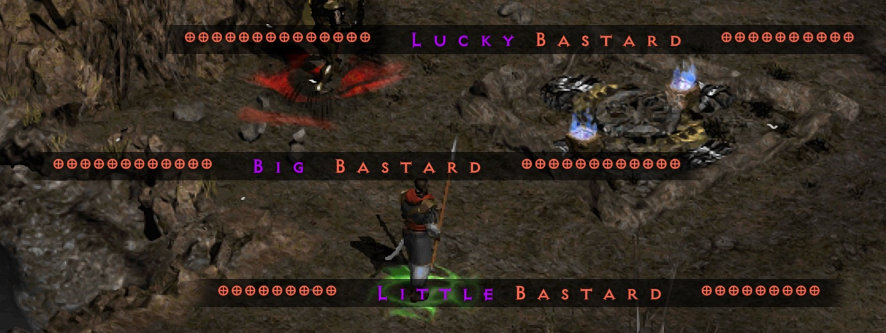](screenshots/MysteryExample2.jpg)

---

## 🎨 Make it yours: Filter Builder

**[Open the Filter Builder](https://roofooevazan.github.io/Roofoo-s-PD2-Loot-Filter/)**: no filter code needed.

- **Colors & sounds:** pick a color theme (Classic, Ember, Frost, Venom, Royal, High Contrast) or restyle any single highlight, and choose drop sounds with previews in your browser.
- **Items:** every unique, set, rare, magic, base, rune, gem and potion in collapsible sections. Change star tiers, turn Mystery drops on or off, and show or hide anything per filter level, narrowed by ethereal, sockets, superior, item level or character level.
- **Test an item** and **Overview & review:** see how any item looks on every filter level, or everything your filter shows and hides, with in-game style item cards on hover.
- **Save & install:** download your `.filter`, share your setup as a link, or load it back later.

The builder always starts from the newest version of this filter, so come back after an update and download again. Your choices are saved in your browser.

Custom versions leave out the [live market prices](#-live-market-prices), which only stay current in the launcher version, and always show items newer than the filter, marked `[Missing]`.

[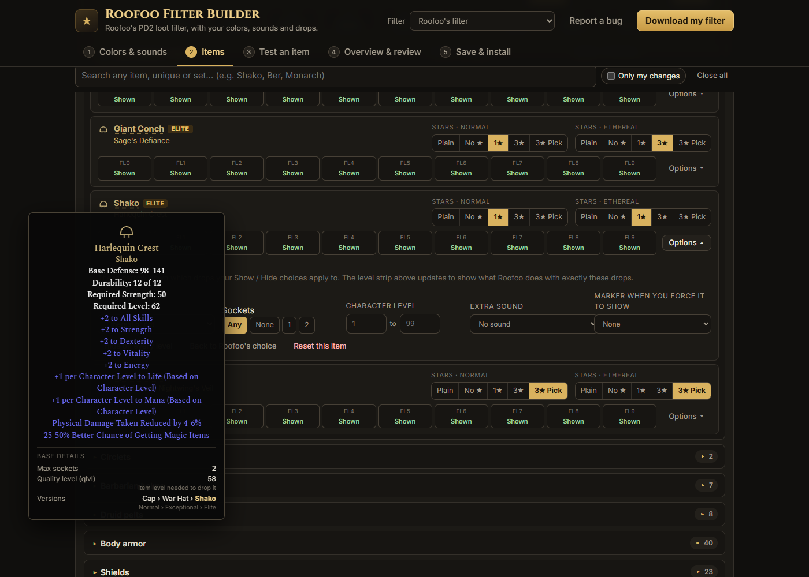](screenshots/BuilderItems.png)

---

## 🗺️ Maps

Maps tell you what matters before you enter.

**Debuffs, worked out for you** (only shown when the map rolled them):

- **Block reduction:** your real block chance after the debuff.
- **FHR reduction:** your real FHR, and frame loss if any.
- **All resistance reduction:** your resistances after the debuff.

**Monster alerts:** quick tags for dangerous or notable spawns: Minions of Destruction, Dolls 💀, Souls ⚡, Cows 🐄, Ghosts, Witches, Fetishes, Vampire Lords, Reanimated Horde and extra boss rolls.

**Melee Splash:** when you roll a map (T1–T3) and its monsters get melee splash, the map's label gets a red **Splash** tag. Every splash map, dungeons included, also says so in its tooltip.

**Monster resistances:** the highest monster resistance values, with 100+ still highlighted as immune.

[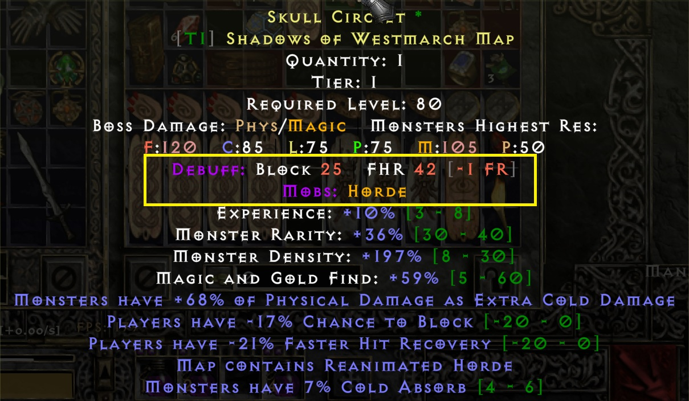](screenshots/MapSmartFilterExample.jpg)
[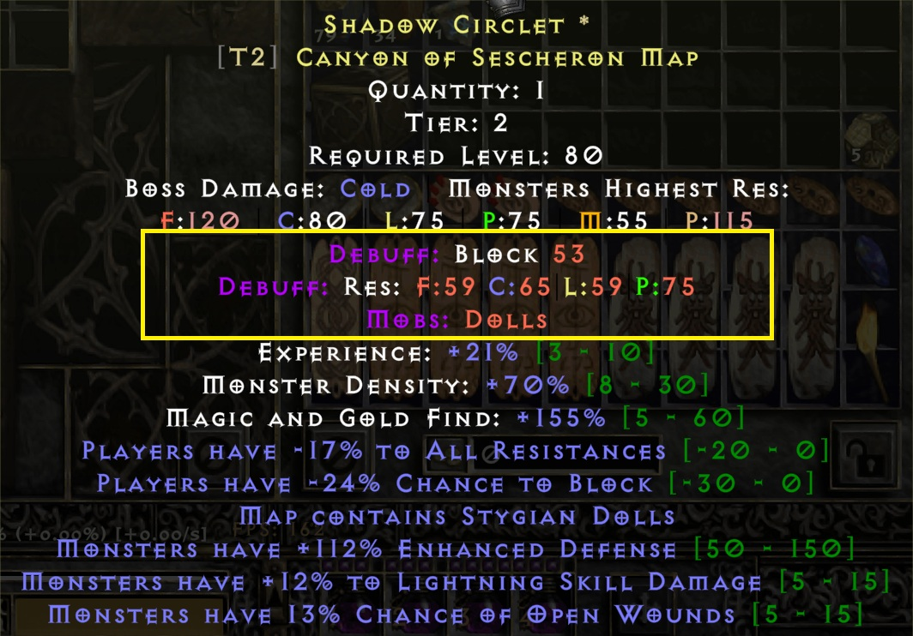](screenshots/MapSmartFilterExample2.jpg)

---

## 💹 Live market prices

Market values from PD2's own market listings and [PD2 Trader](https://pd2trader.com), refreshed in this repository every 6 hours:

- **Rune prices:** median values over the last 24 hours, 48 hours, 72 hours and 1 week on rune stacks, with the current high-rune values on the Horadric Cube.
- **Best-in-slot slams:** on FL4 and FL7, identified uniques and sets show their most valuable corruption and its price range, based on the last 48 hours of listings.
- **Rainbow Facet values** by type and roll, plus key and boss material values.

These only work in the **launcher version**, which gets the updates automatically. Custom versions made with the Filter Builder leave them out instead of letting them go stale.

| BIS slams | Rune prices |
| --- | --- |
| [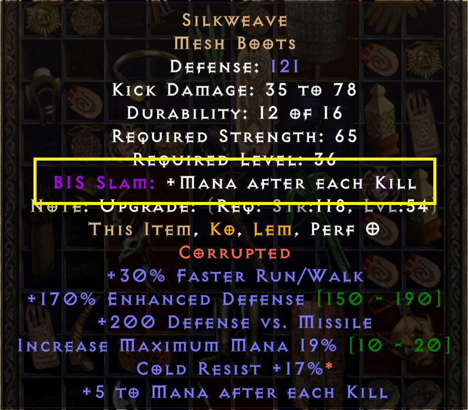](screenshots/BISSlamExample.jpg) | [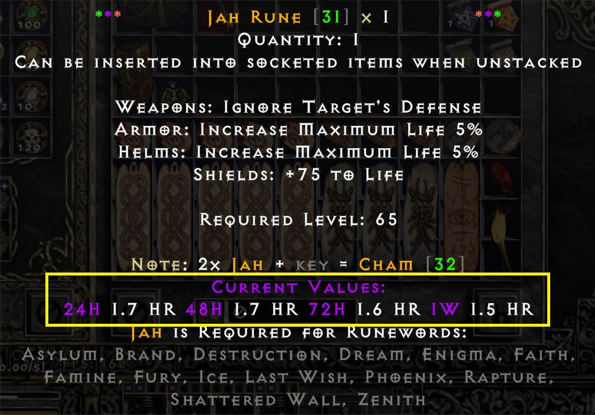](screenshots/RunePriceExample3.jpg) |
| [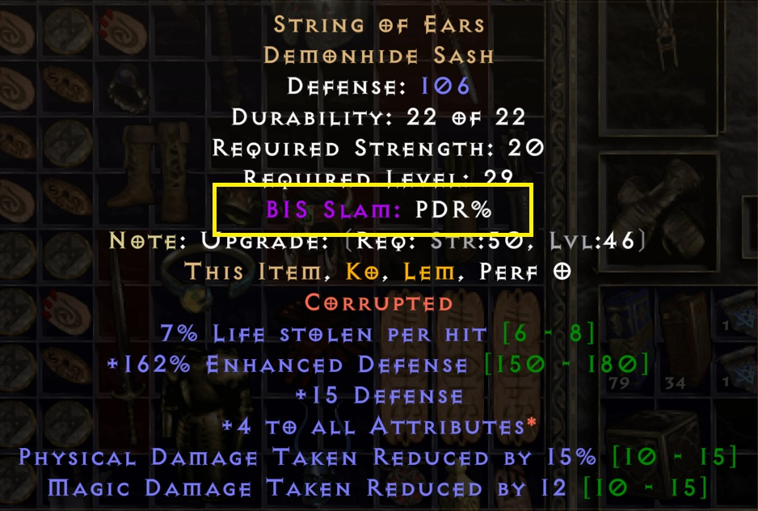](screenshots/BISSlamExample2.jpg) | [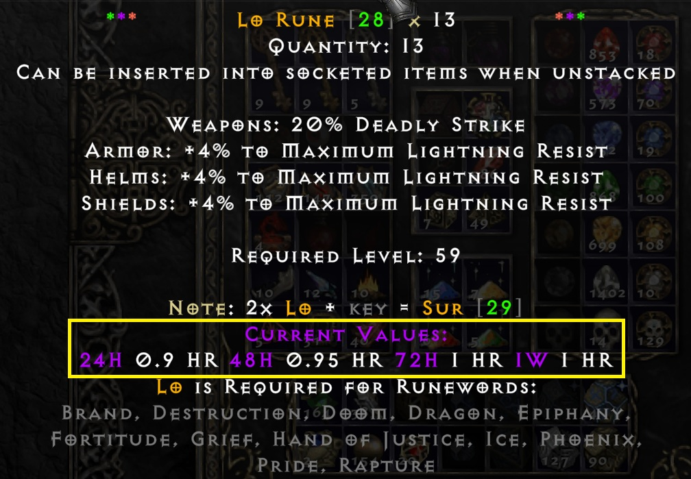](screenshots/RunePriceExample4.jpg) |

---

## 🧹 Item info & quality of life

- **Resistance summaries:** boots, and rare and crafted gear where it matters, show their total resistances on the ground label (Dual, Tri or Quad Res), colored low, medium or high.
- **Short sell values:** vendor prices show as `$35K` instead of long numbers.
- **Base notes:** white bases show their maximum sockets, which runewords fit, and cube upgrade recipes with the requirements after upgrading.
- **Staff mod bases:** white and grey skill weapons worth keeping get a note saying what they're good for.
- **Runes and gems:** runes list the runewords that use them; gems show their cube recipes.
- **Charm tags:** grand, large and small charms are tagged by their useful stats (life, FHR, resistances, skills and more).
- **Alternate skins:** identified uniques that dropped with a 5th Anniversary or Alternative Edition skin get an **[Anniversary]** or **[Alt Edition]** tag.
- **Crafting infusions** show what each craft gives.
- **Shop hunting:** vendor items worth buying are highlighted, from high-skill staff mods to Fire Golem items.

| Dual res | Tri res | Quad res |
| --- | --- | --- |
| [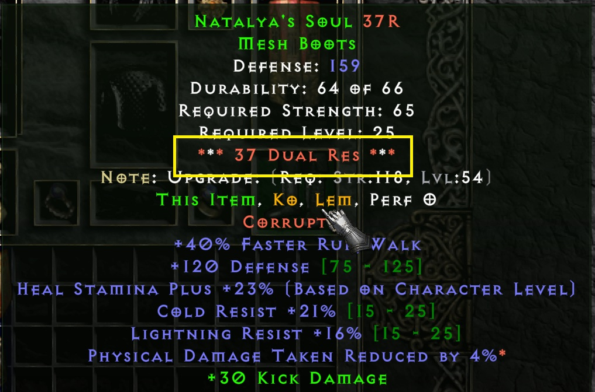](screenshots/BootDualResExample.jpg) | [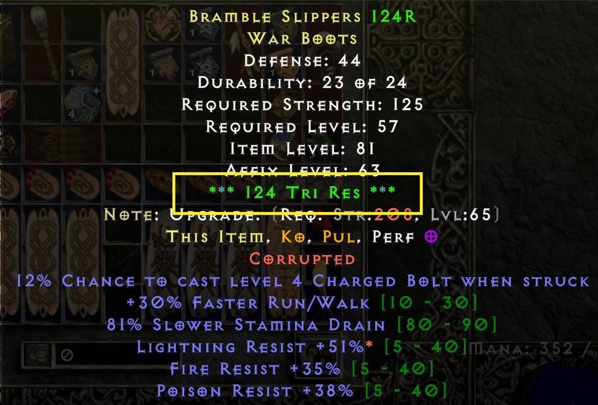](screenshots/BootTriResExample.jpg) | [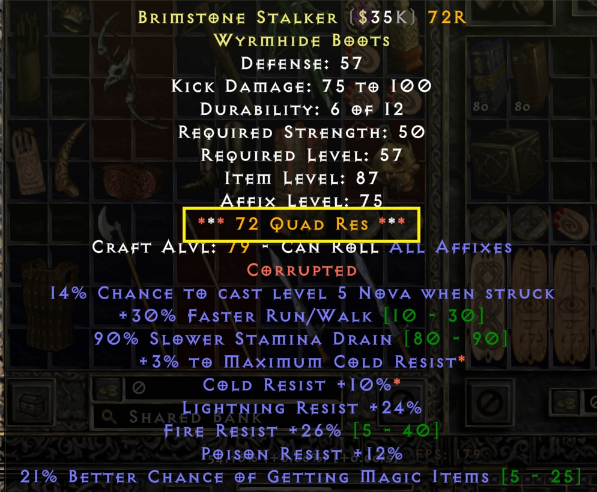](screenshots/BootQuadResExample.jpg) |

---

## 📸 Screenshots

### In game

**Drop notifications**

**Charms & jewels**

**Fire Golem shop highlight**
[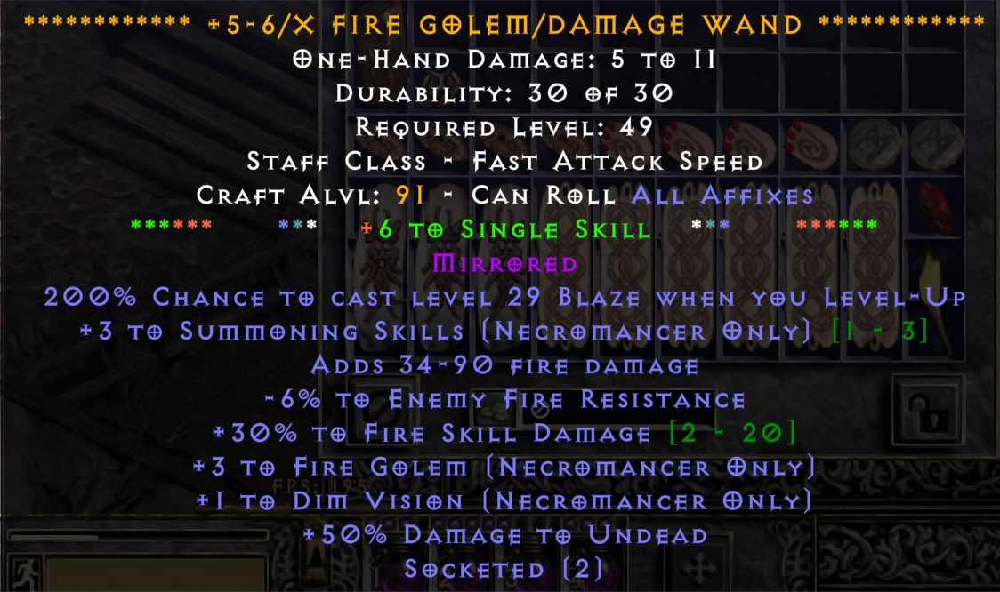](screenshots/FGShop.png)

**Enpherno's Bastard Sword meme drop**

### Filter Builder

**Colors & sounds:** color themes, drop sounds and every highlight style
[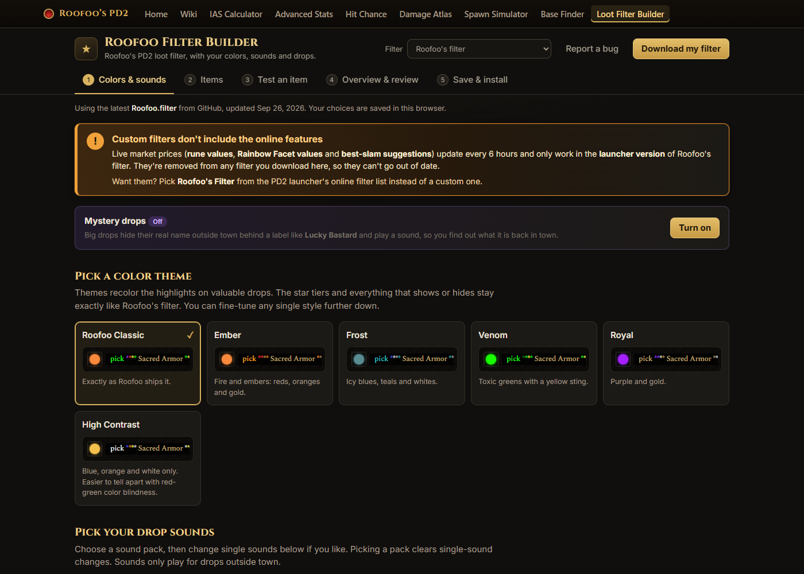](screenshots/BuilderColorsSounds.png)

**Test an item:** how one item looks on every filter level
[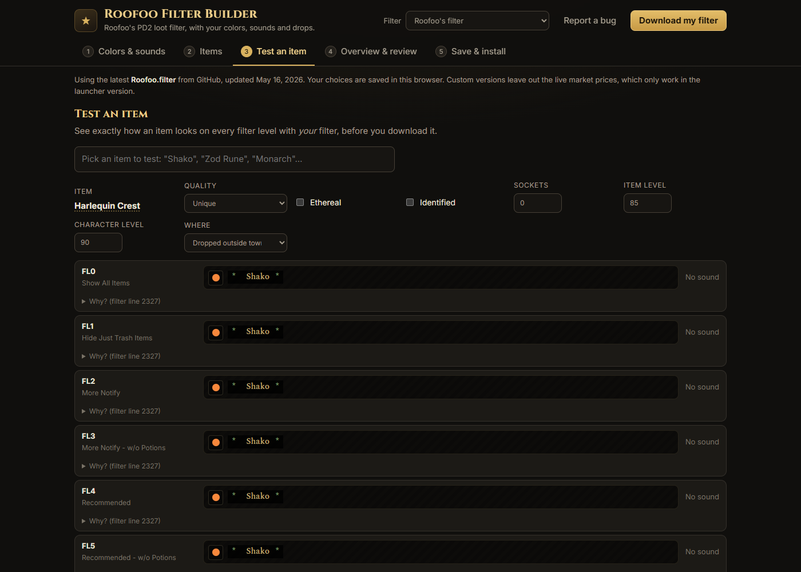](screenshots/BuilderTestItem.png)

**Overview & review:** everything hidden (red) and shown (green) on a filter level, by rarity, sockets and item level
[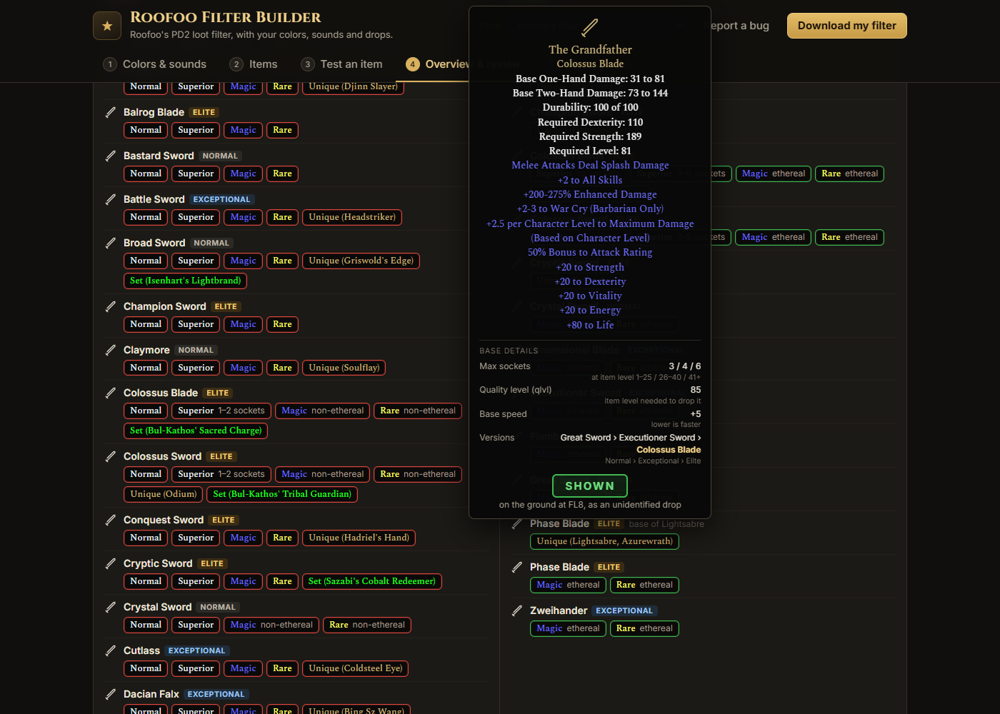](screenshots/BuilderOverview.png)

**Save & install:** download, install steps and the new-item safety net
[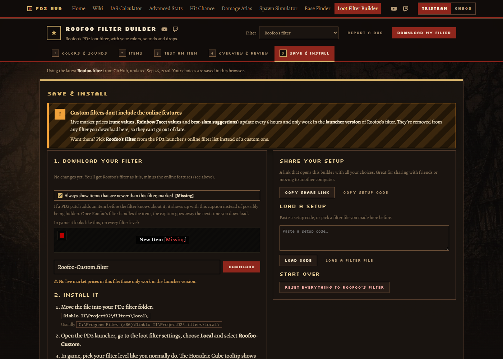](screenshots/BuilderSaveInstall.png)
